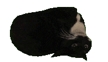
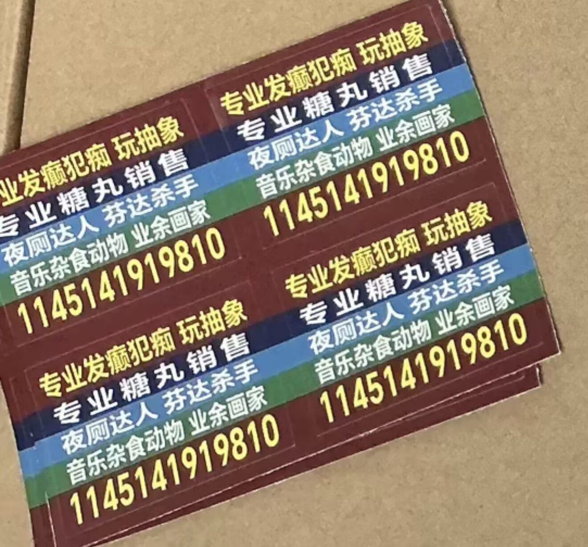
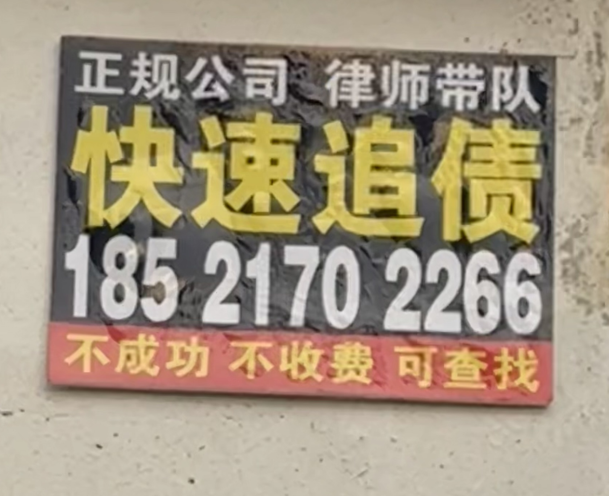
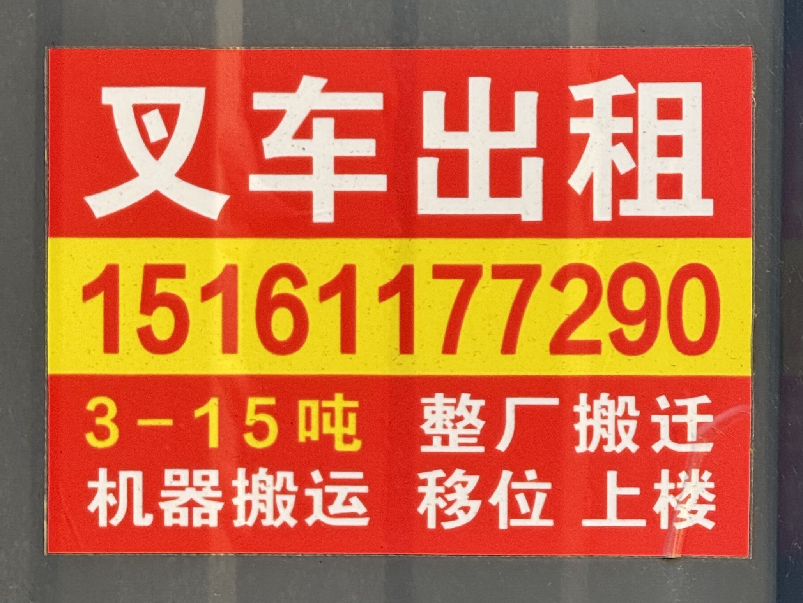
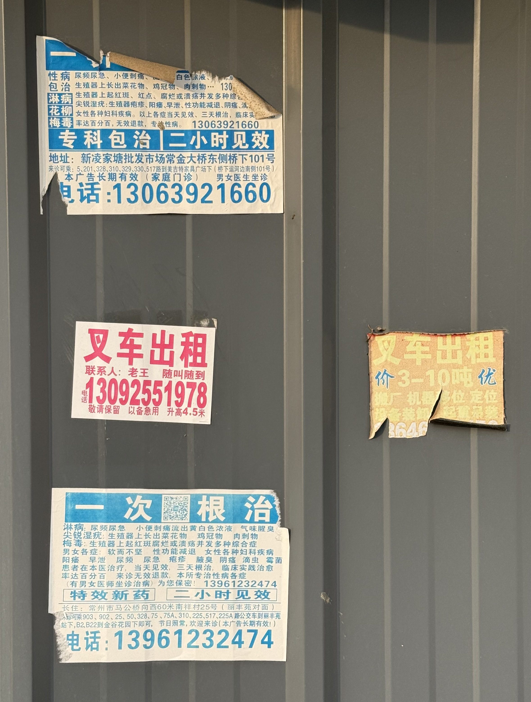

# STICK SOMETHING · 「贴点什么」

一个以中国街头小广告为视觉来源的贴纸编辑器。

`Fatty Games · v0.2.1-beta.1 · 浏览器内测版`

## 0.开始前的一些狡辩

上高中时候，住在常州市中心的一个老小区里（或许压根不算小区，好像是以前的教师公寓），**当然是租房**。楼梯间，除了有蜘蛛网，陈年灰团，烟头化石，还有一些神必的色彩，亮眼夺目吸睛—— **“便民”小广告**。这些小贴纸陪我走了**一鲲年**（约`2.5`年），于是顺理成章成了我的高中美好回忆（perhaps）之一。

也有人叫它 **“城市牛皮癣”**。其实不止老小区楼梯间里，门上，外墙上会有，农村也有很多（甚至有刷在墙上的，`“男科医院”`广告之类的），在城市的电线杆上，公厕墙上，甚至地上也有。

### 0.1倒过来想（迫真）



其实，它们也是一种**另类的民间土特产**。说的**有格调**一点，是一种`vernacular typography（民间视觉）`，兼具极简主义的冷冽和市井生活的烟火.几个色块，几行大字，装着修锁、搬家、找房，以及一些**神必业务**。设计史未必给它们留位置，**但我给了**`（可惜马守恒不是史）`。

### 0.2街头的小广告

我们可以看几个样例，一个高中时候我设计，我的一位友人做成实体的;还有几个在外婆家拍的。

<p>
  
</p>

*自己设计，友人做成实体的。*

<p>
  
  
  
</p>

*在外婆家拍的*

## 1.开始使用

下载离线内测包，解压后用 **Edge 或 Chrome** 打开 `STICK-SOMETHING.html`。可以离线使用，不需要安装。

从源码使用时，先构建，再打开 `dist/STICK-SOMETHING.html`；构建方法见下方。

选一个模板，改文字、调整分区和颜色，再导出图片。想以后继续编辑，就保存一份项目文件。

## 2.操作说明

| 操作 | 方法 |
| --- | --- |
| 新建 | 选择模板或空白画布，设置宽高与形状。 |
| 选择区域 | 点击画布中的区域；上方路径可以选中它的父区域。 |
| 分区 | 将选中区域上下或左右切分，子区域也能继续分。拖动分隔线调整比例，方向键可微调。 |
| 文字 | 在区域内输入文字，调整字体、字号、横竖排、对齐和适配方式。清空文字会保留分区和样式。 |
| 颜色 | 在选色面板中预览，点击下方的大颜色圆圈确认。取消、按 Esc 或点击面板外会恢复原色。 |
| 填充与取色 | 填充工具可以把确认的颜色涂到其他区域；选色面板中的滴管可以从画布取色，取色后仍需确认。 |
| 删除区域 | 右键菜单、属性面板或 Delete。删除父区域会一起删除里面的子区域，其余区域会补满空间；画布不能删除。 |
| 调整画布 | 点击“画布”，随时修改宽高或切换矩形、椭圆；分区比例保留。 |
| 重命名 | 双击文档名称，或聚焦后按 Enter / F2。要修改磁盘文件名，请使用“另存为”。 |
| 保存 | 首次选择保存位置，以后更新同一个项目文件。通过原生“打开”选中的文件也可以直接保存。 |
| 另存为 | 保存按钮的小箭头或右键菜单，可以另选名称和位置；之后保存会更新新文件。 |
| 导出 | 导出 PNG 或 SVG。PNG 保留当前外观；SVG 保留文字，在其他设备查看时需要相同字体。 |

字体列表使用本机字体，也可以填写自定义字体名称；没有安装的字体会使用替代字体。

“下载副本”使用浏览器下载目录，不会更新原文件。若浏览器不支持直接保存，请使用这个选项。关闭前记得保存项目。

### 2.1快捷键

| 快捷键 | 操作 |
| --- | --- |
| Ctrl+N / Ctrl+O | 新建 / 打开 |
| Ctrl+S / Ctrl+Shift+S | 保存 / 另存为 |
| Ctrl+Z / Ctrl+Shift+Z | 撤销 / 重做 |
| Delete | 删除选中区域；输入文字时不删区域 |

撤销最多保留 30 次作品修改。输入框内优先使用文字撤销；新建或打开项目后，撤销记录重新开始。

### 2.2界面设置

默认使用简体中文和 Dark 主题。也可以切换 English、繁體中文、Deutsch、Français，以及 Light 或导入自定义主题。界面主题不会改变作品配色。

主题样例：[paper.json](design/themes/paper.json)。

## 3.后面想做什么

- 或许加一面“墙”，让贴纸有地方可贴，真正 stick something。
- 加一些褪色、撕裂、胶痕之类的做旧效果。
- 再试试更自由的排版和玩法。

## 4.本地开发

需要 **Node.js 20 或以上**，无需安装运行时依赖。

双击 `start-local.cmd`，或在项目目录运行：

```sh
node scripts/serve.mjs
```

打开 [http://127.0.0.1:4173](http://127.0.0.1:4173)。按 Ctrl+C 停止服务。

测试与构建：

```sh
node --test tests/*.test.mjs
node scripts/build.mjs
```

也可以使用 `npm run dev`、`npm test`、`npm run build`。

构建后，`dist/STICK-SOMETHING.html` 是离线单文件；`dist/index.html`、`dist/src` 和 `dist/assets` 用于静态网站部署。

## 5.内测与其他说明

发现问题时，可以通过邮箱联系我。请附上浏览器版本、操作步骤和截图。使用方法见 [内测说明](TEST_GUIDE.md)，打包与发布见 [发布说明](RELEASE_GUIDE.md)，更新记录见 [CHANGELOG](CHANGELOG.md)。

品牌字体使用 Inter 与思源黑体，图标使用 Lucide；相关许可见 [第三方素材说明](assets/THIRD_PARTY.md)。Fatty Games 标志说明见 [品牌素材](assets/branding/README.md)。
